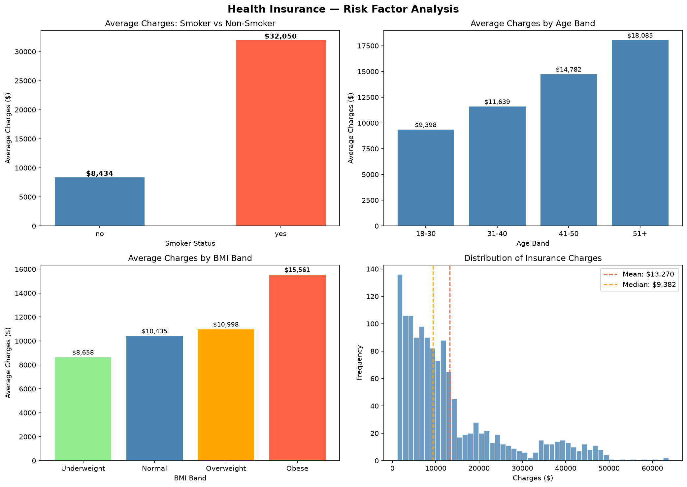
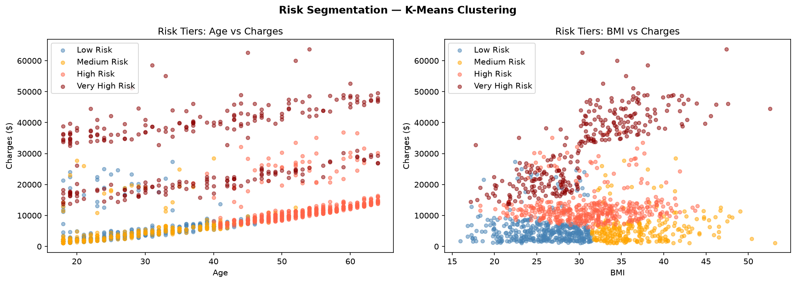
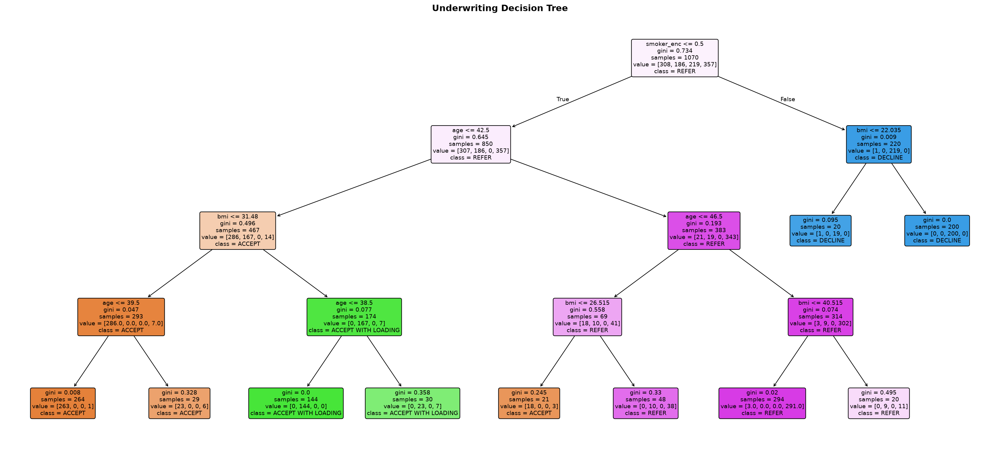
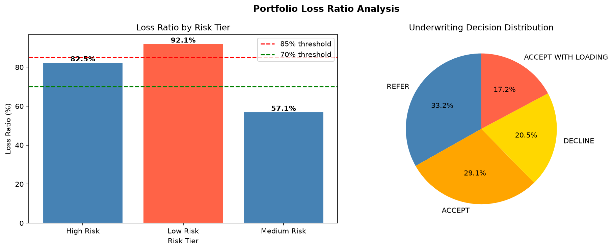

# Health Insurance Underwriting Engine

A placement-level health insurance underwriting project that combines actuarial rating factors, K-Means risk segmentation, and a Decision Tree classifier to produce interpretable accept/refer/decline decisions for individual policyholders.

**Dataset:** [US Health Insurance Dataset](https://www.kaggle.com/datasets/mirichoi0218/insurance) — 1,338 rows, 7 columns  
**Tools:** Python, pandas, scikit-learn, matplotlib, seaborn  
**Outputs:** 4 visualisations, 3 CSVs, interpretable decision tree

---

## Table of Contents

1. [What is Insurance Underwriting?](#what-is-insurance-underwriting)
2. [Project Structure](#project-structure)
3. [Dataset](#dataset)
4. [Step 1 — Exploratory Data Analysis](#step-1--exploratory-data-analysis)
5. [Step 2 — Actuarial Rating Factors](#step-2--actuarial-rating-factors)
6. [Step 3 — Risk Segmentation with K-Means Clustering](#step-3--risk-segmentation-with-k-means-clustering)
7. [Step 4 — Decision Tree Classifier](#step-4--decision-tree-classifier)
8. [Step 5 — Underwriting Output and Premium Loading](#step-5--underwriting-output-and-premium-loading)
9. [Step 6 — Loss Ratio Analysis](#step-6--loss-ratio-analysis)
10. [Key Results](#key-results)
11. [How to Run](#how-to-run)
12. [Interview Explanation](#interview-explanation)

---

## What is Insurance Underwriting?

**Underwriting** is the process by which an insurance company decides:
- Whether to insure a particular person
- At what price (premium) to insure them
- Whether any special conditions apply

An underwriter evaluates risk. If someone is likely to make large claims, the insurer either charges them more (premium loading), sends them to a senior specialist (refer), or refuses to insure them (decline). If someone is low risk, they are accepted at the standard premium.

The goal of underwriting is not to reject everyone — it is to make sure that every accepted policy is priced correctly so the insurer remains profitable. Too cheap on high-risk people and the company loses money. Too expensive on low-risk people and they go elsewhere.

**Key terms used throughout this project:**

| Term | Definition |
|------|-----------|
| Premium | The amount the policyholder pays to the insurer every year |
| Claim | The amount the insurer pays out when the policyholder uses healthcare |
| Charges | In this dataset, the annual medical cost billed to the insurer — used as a proxy for claims |
| Base Rate | The average charge across all policyholders — the starting point for pricing |
| Rating Factor | A multiplier that adjusts the base rate based on a risk characteristic |
| Relativity | Another word for rating factor — how much a group's cost differs from average |
| Loading | A percentage added to the base premium for higher-risk applicants |
| Loss Ratio | Total claims paid out divided by total premiums collected |
| Risk Tier | A category (Low/Medium/High/Very High) summarising an applicant's overall risk |

---

## Project Structure

```
underwriting/
├── underwriting_project.py     # Full pipeline
├── insurance.csv               # Source data (download from Kaggle)
├── underwriting_output.csv     # Per-applicant decisions
├── rating_factors.csv          # Actuarial relativity table
├── loss_ratio_summary.csv      # Portfolio profitability by segment
├── eda_risk_factors.png        # EDA charts
├── risk_segmentation.png       # K-Means cluster plots
├── decision_tree.png           # Decision tree visual
└── loss_ratio_analysis.png     # Loss ratio and decision mix
```

---

## Dataset

**Source:** US Health Insurance Dataset, Kaggle  
**Size:** 1,338 policyholders, 7 columns  
**Missing values:** None  

| Column   | Type    | Description                                        |
|----------|---------|----------------------------------------------------|
| age      | integer | Policyholder age (18 to 64)                        |
| sex      | string  | male or female                                     |
| bmi      | float   | Body Mass Index (weight in kg / height in m²)      |
| children | integer | Number of dependants covered (0 to 5)              |
| smoker   | string  | yes or no                                          |
| region   | string  | northeast / northwest / southeast / southwest (US) |
| charges  | float   | Annual medical charges billed (USD)                |

### Summary Statistics

| Variable | Mean    | Std Dev  | Min     | Median  | Max      |
|----------|---------|----------|---------|---------|----------|
| age      | 39.2    | 14.1     | 18      | 39      | 64       |
| bmi      | 30.7    | 6.1      | 16.0    | 30.4    | 53.1     |
| children | 1.09    | 1.21     | 0       | 1       | 5        |
| charges  | $13,270 | $12,110  | $1,122  | $9,382  | $63,770  |

The large standard deviation in charges ($12,110) relative to the mean ($13,270) tells us there is enormous variation in costs — a small number of very expensive policyholders pulling the average up significantly. The median ($9,382) is much lower than the mean, confirming this right-skew.

**BMI Classification (WHO Standard):**

| BMI Range  | Category    |
|------------|-------------|
| Below 18.5 | Underweight |
| 18.5–24.9  | Normal      |
| 25.0–29.9  | Overweight  |
| 30.0+      | Obese       |

---

## Step 1 — Exploratory Data Analysis

**What is EDA?**  
Exploratory Data Analysis is the process of understanding the data before building any model. We look at distributions, relationships between variables, and anything unusual. In insurance, EDA tells us which characteristics (age, BMI, smoking) actually drive high claims — so we know what to model.

The output is saved as `eda_risk_factors.png` — a 2x2 panel of four charts.

---

### Chart 1: Average Charges — Smoker vs Non-Smoker

**What the chart shows:** Two bars comparing the average annual medical charge for smokers (yes) and non-smokers (no).

**What we see:**

| Group       | Average Charges |
|-------------|-----------------|
| Non-Smoker  | $8,434          |
| Smoker      | $32,050         |

Smokers cost nearly **4x more** than non-smokers. This is the single strongest risk factor in the dataset.

**Why this matters for underwriting:** No underwriter can ignore smoking status. A smoker paying the same premium as a non-smoker would create a massive loss — the insurer would collect $8,434 worth of premium but pay out $32,050 in claims. This is why smoker status is a mandatory rating factor in health insurance.

**Medical explanation:** Smoking causes lung cancer, COPD, cardiovascular disease, and stroke — all conditions that generate sustained, high-cost healthcare use. These are not one-off claims but years of ongoing treatment.

---

### Chart 2: Average Charges by Age Band

**What the chart shows:** Four bars showing average charges for each of four age bands (18–30, 31–40, 41–50, 51+).

**What we see:**

| Age Band | Average Charges | Change from Previous Band |
|----------|-----------------|--------------------------|
| 18–30    | $9,398          | —                        |
| 31–40    | $11,639         | +$2,241 (+24%)           |
| 41–50    | $14,782         | +$3,143 (+27%)           |
| 51+      | $18,085         | +$3,303 (+22%)           |

Charges increase by roughly 20–27% with each decade of age. The 51+ band costs nearly **twice** as much as the 18–30 band.

**Why this matters for underwriting:** Older people use healthcare more frequently. They accumulate chronic conditions (diabetes, hypertension, arthritis) that require regular treatment and medication. Charging a 55-year-old the same premium as a 22-year-old would be actuarially unsound — the premium would be insufficient to cover expected claims.

**Age banding** is used rather than a continuous age variable because:
1. It is easier to explain to policyholders
2. It avoids extreme sensitivity to exact age
3. It is the industry standard for group health insurance rating

---

### Chart 3: Average Charges by BMI Band

**What the chart shows:** Four bars for each BMI category using the WHO classification.

**What we see:**

| BMI Band    | BMI Range  | Average Charges |
|-------------|------------|-----------------|
| Underweight | < 18.5     | $8,658          |
| Normal      | 18.5–24.9  | $10,435         |
| Overweight  | 25–29.9    | $10,998         |
| Obese       | ≥ 30       | $15,561         |

Obese policyholders cost 43% more than underweight ones and 49% more than those with a normal BMI.

**Why this matters for underwriting:** Obesity is directly linked to type 2 diabetes, hypertension, cardiovascular disease, joint problems, and sleep apnoea. These conditions are expensive to manage long-term. Unlike smoking (a binary yes/no), BMI gives a graded risk — the higher the BMI, the higher the expected cost.

**Note on the Obese category:** BMI ≥ 30 covers a very wide range — a person with BMI 31 is categorised the same as someone with BMI 50, even though their risk is very different. In real underwriting, the obese band is often split further (e.g. 30–35, 35–40, 40+). The cluster analysis in Step 3 captures this more granularly.

---



### Chart 4: Distribution of Insurance Charges

**What the chart shows:** A histogram of all 1,338 policyholders' annual charges, with vertical lines marking the mean ($13,270 in red) and the median ($9,382 in orange).

**What we see:**  
The distribution is strongly **right-skewed** — the long tail extends to the right. Most policyholders cluster in the $1,000–$15,000 range, but a significant number have charges above $30,000, and some reach $60,000+.

**Why the mean is above the median:** When a distribution is right-skewed, a small number of very large values pull the mean upward. The median is not affected by these outliers. In this dataset, the mean ($13,270) is $3,888 higher than the median ($9,382) — entirely because of a relatively small number of very high-cost policyholders (mostly smokers).

**What this means for pricing:** If an insurer priced every policy at the median ($9,382), they would lose money — the average cost they actually pay out is $13,270. This is why actuaries use the mean for premium setting, not the median. The distribution also justifies why we need to segment policyholders: a one-size-fits-all premium cannot work when some individuals cost $1,000 and others cost $63,000.

**Two humps visible in the histogram:** Looking carefully, the distribution has a primary peak around $3,000–$5,000 (non-smokers, younger) and a secondary cluster around $35,000–$45,000 (smokers). This bimodal shape is a visual confirmation that smokers and non-smokers form two fundamentally different risk populations.

---

## Step 2 — Actuarial Rating Factors

**What is actuarial rating?**  
Actuarial rating is the methodology insurers use to price individual policies. Instead of charging everyone the same amount, the insurer adjusts the base premium up or down based on the policyholder's specific risk characteristics. Each adjustment is expressed as a **relativity** — a multiplier.

This approach is the standard in all personal lines insurance (health, auto, home). It is regulated — insurers must justify their rating factors with data.

### Base Rate

```
Base Rate = Overall average charges across all policyholders

Base Rate = $13,270.42
```

The base rate is the premium you would charge if you knew nothing about the individual — you would simply charge everyone the population average. Rating factors then adjust this up or down based on what you do know about them.

### Relativity Formula

```
Relativity = Average Charges for that group / Overall Base Rate
```

For example, smokers:

```
Smoker Relativity = $32,050 / $13,270 = 2.415
```

This means smokers cost 2.415 times the average. A relativity of 1.0 means a group costs exactly the average. Above 1.0 means higher than average cost. Below 1.0 means lower than average cost.

### Full Rating Factor Table

| Factor          | Relativity | What This Means                            |
|-----------------|------------|--------------------------------------------|
| Non-Smoker      | 0.636      | 36% below average cost                    |
| Smoker          | 2.415      | 141% above average cost                   |
| Age 18–30       | 0.708      | 29% below average cost                    |
| Age 31–40       | 0.877      | 12% below average cost                    |
| Age 41–50       | 1.114      | 11% above average cost                    |
| Age 51+         | 1.363      | 36% above average cost                    |
| BMI Underweight | 0.652      | 35% below average cost                    |
| BMI Normal      | 0.786      | 21% below average cost                    |
| BMI Overweight  | 0.829      | 17% below average cost                    |
| BMI Obese       | 1.173      | 17% above average cost                    |

### Premium Calculation Formula

```
Base Premium = Base Rate × Smoker Relativity × Age Band Relativity × BMI Band Relativity
```

This is a **multiplicative model** — each factor multiplies the previous result. This is the standard approach in insurance rating because risk factors interact multiplicatively, not additively.

**Why multiplicative and not additive?**  
Suppose being a smoker adds $19,000 (the smoker–non-smoker gap). If we used additive factors, a young non-obese person would get:

```
$13,270 + $19,000 = $32,270 (smoker premium — seems large but let's continue)
```

Now a 55-year-old obese smoker: we'd just keep adding. But in reality, a 55-year-old obese smoker's costs are not the sum of three independent penalties. Obesity at age 55 combined with smoking creates compounding health risks — the interaction is multiplicative. Multiplicative models capture this correctly.

### Worked Example

A 45-year-old male non-smoker with BMI 28 (overweight):

```
Age band:   41–50        → relativity 1.114
Smoker:     no           → relativity 0.636
BMI band:   Overweight   → relativity 0.829

Base Premium = $13,270 × 1.114 × 0.636 × 0.829
             = $13,270 × 0.5864
             = $7,782
```

A 38-year-old female smoker with BMI 34 (obese):

```
Age band:   31–40        → relativity 0.877
Smoker:     yes          → relativity 2.415
BMI band:   Obese        → relativity 1.173

Base Premium = $13,270 × 0.877 × 2.415 × 1.173
             = $13,270 × 2.484
             = $32,963
```

The same base rate produces very different premiums depending on the individual's risk profile.

---

## Step 3 — Risk Segmentation with K-Means Clustering

**What is K-Means Clustering?**  
K-Means is an **unsupervised machine learning** algorithm that groups data points into K clusters based on similarity. It does not use any pre-defined labels — it finds natural groupings in the data by minimising the distance between each point and its cluster centre.

**Unsupervised** means we are not telling the algorithm what the answer should be. We are saying: "find natural groups in this data" — and it does so without being given any outcome variable to predict.

### The K-Means Algorithm

Step by step:

```
1. Choose K = 4 (we want 4 risk tiers)
2. Randomly place 4 cluster centres in the data space
3. Assign each data point to its nearest cluster centre
4. Recalculate each cluster centre as the mean of all points assigned to it
5. Repeat steps 3-4 until cluster assignments stop changing
```

The algorithm minimises within-cluster variance:

```
Objective = minimise SUM over all clusters of SUM over all points in cluster of (distance from point to cluster centre)^2
```

### Why Standardise the Features?

Before clustering, all features are standardised:

```
Standardised value = (Original value - Mean) / Standard Deviation
```

This is necessary because K-Means uses Euclidean distance. Without standardisation, charges (which range from $1,000 to $63,000) would completely dominate age (18 to 64) and BMI (16 to 53). Standardising puts all variables on the same scale so each contributes equally to the distance calculation.

### Features Used for Clustering

```
age, bmi, smoker (encoded as 0 for no, 1 for yes), charges
```

Note that charges is included in clustering because we want to find risk groups partly defined by their actual cost history. This is the actuarial approach — group people who actually behave similarly.

### Why 4 Clusters?

Four clusters map neatly to the four standard underwriting decisions:
```
Low Risk       → ACCEPT
Medium Risk    → ACCEPT WITH LOADING
High Risk      → REFER
Very High Risk → DECLINE
```

We ran K-Means for K = 2 through K = 7 and confirmed that 4 clusters provides a good balance between fit and interpretability (elbow method check on inertia).

### Risk Tier Results

| Risk Tier      | Count | Avg Age | Avg BMI | % Smoker | Avg Charges | Charge Range         |
|----------------|-------|---------|---------|----------|-------------|----------------------|
| Low Risk       | 384   | 29.2    | 25.9    | 0%       | $5,425      | $1,122 – $27,376     |
| Medium Risk    | 252   | 30.7    | 37.0    | 0%       | $5,839      | $1,136 – $28,477     |
| High Risk      | 429   | 53.5    | 31.2    | 0%       | $12,663     | $6,185 – $36,911     |
| Very High Risk | 273   | 38.6    | 30.8    | 100%     | $32,121     | $13,748 – $63,770    |

### How to Read This Table

**Low Risk (384 people):** Young (avg 29), normal BMI (avg 25.9), zero smokers, low charges ($5,425 avg). These are the ideal policyholders — young, healthy, non-smokers. Straightforward accepts.

**Medium Risk (252 people):** Similarly young (avg 30.7) and zero smokers, but higher BMI (avg 37.0 — obese range). Their charges are similar to Low Risk despite higher BMI. This is an interesting finding: high BMI alone does not dramatically increase charges in younger people, but creates a risk concern for future health trajectory. The 20% loading reflects this future risk rather than current cost.

**High Risk (429 people):** The oldest group (avg 53.5), moderately obese, zero smokers. Their charges ($12,663) are driven purely by age — accumulated chronic conditions in older non-smokers. These are referred because their risk profile warrants senior underwriter review, particularly for any pre-existing condition disclosures.

**Very High Risk (273 people):** 100% smokers. Average age 38.6 — not particularly old. Average charges $32,121 — more than twice the High Risk group despite being younger. This confirms that smoking alone is sufficient to create extreme cost regardless of age.

### Cluster Visualisations



**Left plot — Age vs Charges:**  
The four risk tiers form distinct bands on this scatter. The Very High Risk (dark red) dots sit at the top across all ages — high charges regardless of how old the person is. The High Risk (salmon/pink) dots form a rising band from the middle-right area, climbing as age increases. The Low Risk (blue) and Medium Risk (orange) dots cluster at the bottom-left — young and cheap.

**Right plot — BMI vs Charges:**  
The Very High Risk cluster (dark red) hovers at the top across all BMI values. This confirms that it is smoking, not BMI, that defines this cluster. The other three tiers are bunched together at the bottom regardless of BMI — BMI alone does not create the dramatic charge differences that smoking does.

---

## Step 4 — Decision Tree Classifier

**What is a Decision Tree?**  
A Decision Tree is a supervised machine learning model that learns a set of if-then-else rules to classify data. It works by repeatedly asking questions about the input features ("is this person a smoker?", "is their age above 42?") and splitting the data based on the answers until it reaches a decision.

**Supervised** means the algorithm is trained on labelled examples — it learns from data where we already know the correct answer (the risk tier from clustering).

**Why a Decision Tree and not logistic regression or a neural network?**  
- **Interpretability:** Every decision is traceable. An underwriter can look at the tree and understand exactly why an applicant was accepted or declined. Regulators require this.
- **No black box:** A neural network might achieve higher accuracy but cannot explain its decisions. In insurance, explainability is not optional.
- **Easy to validate:** Any analyst can check whether the tree's rules make business sense.

### How the Tree is Built

The Decision Tree uses **Gini impurity** to decide which feature to split on at each node.

**Gini impurity** measures how mixed the classes are at a node:

```
Gini = 1 - SUM of (proportion of class i in node)^2

A perfectly pure node (all one class) has Gini = 0
A perfectly mixed node (equal split between all classes) has maximum Gini
```

At each split, the algorithm tries every possible threshold for every feature and picks the split that most reduces Gini impurity — i.e. makes the resulting groups as pure as possible.

**Example:** At the root of our tree, the first split is `smoker_enc <= 0.5`. This means:
- If smoker = 0 (non-smoker): go left
- If smoker = 1 (smoker): go right

This split reduces impurity the most because smokers and non-smokers have dramatically different class distributions — splitting on smoking first immediately separates the Very High Risk group from the rest.

### Tree Parameters

```
max_depth = 4         # Tree stops splitting after 4 levels
min_samples_leaf = 20 # A leaf node must have at least 20 policyholders
random_state = 42     # For reproducibility
```

**Why max_depth = 4?**  
A deeper tree would fit the training data more precisely but would memorise noise rather than learning genuine patterns (overfitting). At depth 4, the tree is readable and still achieves 93% accuracy.

### Training and Test Split

```
Training set: 80% of data (1,070 policyholders)
Test set:     20% of data (268 policyholders)
```

The model is trained on 1,070 examples and evaluated on 268 it has never seen.

### Model Performance — Classification Report

**Test set accuracy: 93%**

| Decision             | Precision | Recall | F1-Score | Support |
|----------------------|-----------|--------|----------|---------|
| ACCEPT               | 0.95      | 0.95   | 0.95     | 76      |
| ACCEPT WITH LOADING  | 0.98      | 0.83   | 0.90     | 66      |
| DECLINE              | 1.00      | 1.00   | 1.00     | 54      |
| REFER                | 0.82      | 0.93   | 0.87     | 72      |

**How to read this table:**

**Precision** = Of all the times the model predicted this class, what fraction was correct?  
```
Precision for DECLINE = 1.00 → Every time the model said DECLINE, it was right
```

**Recall** = Of all the actual examples of this class, what fraction did the model find?  
```
Recall for ACCEPT = 0.95 → The model correctly identified 95% of all actual ACCEPTs
```

**F1-Score** = Harmonic mean of precision and recall — the overall quality metric for each class  
```
F1 = 2 × (Precision × Recall) / (Precision + Recall)
```

**Support** = Number of actual examples of that class in the test set.

**Key findings:**
- DECLINE: 100% precision and recall — the model never misclassifies a smoker who should be declined, and never wrongly declines someone
- ACCEPT WITH LOADING: 83% recall — 17% of medium-risk applicants are misclassified (mostly sent to REFER instead)
- REFER: 82% precision — some non-referrals get labelled as REFER (conservative errors, safer than the reverse)

### Feature Importance

Feature importance measures how much each variable contributed to the tree's decisions:

```
age         0.3589   (35.9% of decisions)
smoker_enc  0.3240   (32.4% of decisions)
bmi         0.3171   (31.7% of decisions)
children    0.0000   (0% — not used)
sex_enc     0.0000   (0% — not used)
region_enc  0.0000   (0% — not used)
```

Age, smoking, and BMI together explain 100% of the tree's decisions. Sex, region, and number of children are irrelevant to cost once age, BMI, and smoking are accounted for. This is consistent with the EDA findings.

### Reading the Decision Tree



The tree is visualised as a flow of boxes (nodes) connected by branches.

**How to read each box:**
```
smoker_enc <= 0.5       ← The splitting rule
gini = 0.734            ← Impurity before this split (0 = pure, higher = mixed)
samples = 1070          ← Number of policyholders reaching this node
value = [308, 186, 219, 357]  ← Count in each class [ACCEPT, ACCEPT W/ LOADING, DECLINE, REFER]
class = REFER           ← Majority class at this node
```

**Tracing a path through the tree:**

Example — 19-year-old female smoker, BMI 27.9:
```
Root: smoker_enc <= 0.5 → False (she is a smoker) → go RIGHT
Right node: bmi <= 22.035 → False (BMI 27.9 > 22.035) → go RIGHT
→ DECLINE
```

Example — 33-year-old male non-smoker, BMI 22.7:
```
Root: smoker_enc <= 0.5 → True (non-smoker) → go LEFT
age <= 42.5 → True (33 < 42.5) → go LEFT
bmi <= 31.48 → True (22.7 < 31.48) → go LEFT
age <= 39.5 → True (33 < 39.5) → go LEFT
→ ACCEPT
```

The tree's logic is fully transparent. Any decision can be explained in plain English to the policyholder or a regulator.

---

## Step 5 — Underwriting Output and Premium Loading

### Premium Loading

Once a risk tier and underwriting decision are assigned, the base premium is adjusted:

```
ACCEPT              → Loading = 0%   (no adjustment — standard premium)
ACCEPT WITH LOADING → Loading = 20%  (moderate risk premium increase)
REFER               → Loading = 40%  (high-risk premium, pending review)
DECLINE             → No premium issued (policy not written)
```

### Final Premium Formula

```
Final Premium = Base Premium × (1 + Loading Percentage)
```

**Examples:**

A 18-year-old male non-smoker, BMI 33.8 (Medium Risk — ACCEPT WITH LOADING):
```
Base Premium = $7,004
Loading = 20%
Final Premium = $7,004 × 1.20 = $8,405
```

A 46-year-old female non-smoker, BMI 33.4 (High Risk — REFER):
```
Base Premium = $11,017
Loading = 40%
Final Premium = $11,017 × 1.40 = $15,424
```

A 19-year-old female smoker, BMI 27.9 (Very High Risk — DECLINE):
```
Base Premium = $18,810
Final Premium = Not issued (declined)
```

### Underwriting Decision Distribution

Out of 1,338 applicants:

| Decision             | Count | Share |
|----------------------|-------|-------|
| REFER                | 444   | 33.2% |
| ACCEPT               | 390   | 29.1% |
| DECLINE              | 274   | 20.5% |
| ACCEPT WITH LOADING  | 230   | 17.2% |

One in five applicants is declined (all smokers). One in three is referred — typically older non-smokers with elevated BMI who need senior review. Together, 46.1% of applicants are either declined or referred, reflecting the genuine risk concentration in this dataset.

### Sample Underwriting Output Table

| Age | Sex    | BMI   | Smoker | Risk Tier      | Decision             | Loading | Base Premium | Final Premium | Actual Charges |
|-----|--------|-------|--------|----------------|----------------------|---------|--------------|---------------|----------------|
| 19  | female | 27.9  | yes    | Very High Risk | DECLINE              | —       | $18,810      | —             | $16,885        |
| 18  | male   | 33.8  | no     | Medium Risk    | ACCEPT WITH LOADING  | 20%     | $7,004       | $8,404        | $1,726         |
| 46  | female | 33.4  | no     | High Risk      | REFER                | 40%     | $11,017      | $15,423       | $8,241         |
| 33  | male   | 22.7  | no     | Low Risk       | ACCEPT               | 0%      | $5,817       | $5,817        | $21,984        |
| 60  | female | 25.8  | no     | High Risk      | REFER                | 40%     | $9,526       | $13,336       | $28,923        |

**Note on the 33-year-old male (row 4):** His actual charges ($21,984) far exceed his premium ($5,817). This is a limitation of the actuarial model — individual outcomes are unpredictable even when average costs for the group are low. This is why insurance pools risk across many policyholders: the losses on some are covered by the profits on others.

---

## Step 6 — Loss Ratio Analysis

**What is Loss Ratio?**  
The loss ratio is the most important profitability metric in insurance. It tells you what fraction of the premium collected is paid back out as claims.

### Formula

```
Loss Ratio = Total Claims Paid / Total Premium Collected × 100
```

**Industry benchmarks:**
```
Loss Ratio < 70%:  Insurer is overcharging — risk of customer loss, regulatory scrutiny
Loss Ratio 70–85%: Healthy range — profitable and competitively priced
Loss Ratio > 85%:  Premiums insufficient — insurer may be losing money
Loss Ratio > 100%: Insurer is paying out more than it collects — unsustainable
```

The remainder (100% minus loss ratio) covers the insurer's operating expenses and profit margin. A 78.6% loss ratio leaves 21.4% for expenses and profit — typical for a well-run health insurer.

### Loss Ratio by Risk Tier

Only accepted applicants (ACCEPT, ACCEPT WITH LOADING, REFER) are included. Declined applicants generate no premium and no claims.

| Risk Tier   | Policies | Total Claims   | Total Premium  | Avg Claim   | Avg Premium | Loss Ratio | Profitable |
|-------------|----------|----------------|----------------|-------------|-------------|------------|------------|
| High Risk   | 429      | $5,432,225     | $6,587,602     | $12,663     | $15,356     | 82.5%      | Yes        |
| Low Risk    | 383      | $2,070,424     | $2,248,486     | $5,406      | $5,871      | 92.1%      | No         |
| Medium Risk | 252      | $1,471,413     | $2,577,943     | $5,839      | $10,230     | 57.1%      | Yes        |

**Overall Portfolio Loss Ratio: 78.6%** — within the healthy 70–85% target band.

### Detailed Interpretation of Each Segment

**High Risk — Loss Ratio 82.5% (Profitable)**  
The 40% loading applied to REFER decisions is working. Average premium ($15,356) is sufficiently above average claims ($12,663). The extra loading compensates for the age-driven cost of this group. This is the largest segment by volume (429 policies) and it is priced correctly.

**Low Risk — Loss Ratio 92.1% (Not Profitable)**  
The zero loading means premium = base rate = $5,871 average. But the actual average claim is $5,406 — very close to the premium. With no loading buffer, any unexpected claims push this segment into loss. The 92.1% loss ratio exceeds the 85% threshold.

This is a **pricing adequacy problem**: the base rate for young, low-BMI non-smokers is slightly too low relative to their actual claims. In a real portfolio, this would trigger a base rate review. Options include: a small upward revision to the base rate, or applying a modest 5–10% loading to Low Risk rather than zero.

**Medium Risk — Loss Ratio 57.1% (Profitable but overpriced)**  
The 20% loading combined with a young, lower-cost population creates a large premium-to-claim gap. Average premium ($10,230) is 75% above average claims ($5,839). This means medium-risk policyholders are being significantly overcharged.

This creates a **competitive risk**: other insurers offering lower premiums could attract this segment away. A loss ratio this low also invites regulatory scrutiny — insurers are expected to price fairly. The 20% loading on Medium Risk may be too aggressive given their actual charge profile.

### Loss Ratio Chart



**Left chart — Loss Ratio by Risk Tier (bar chart with threshold lines):**  
Three bars for High, Low, and Medium Risk. A red dashed line at 85% marks the upper acceptable threshold. A green dashed line at 70% marks the lower bound. High Risk (82.5%) sits comfortably inside the target band. Low Risk (92.1%) breaches the red line — shown in a different colour. Medium Risk (57.1%) sits well below the green line.

**Right chart — Underwriting Decision Distribution (pie chart):**  
A pie chart showing what proportion of all 1,338 applicants received each decision. REFER is the largest slice (33.2%), followed by ACCEPT (29.1%), DECLINE (20.5%), and ACCEPT WITH LOADING (17.2%). This gives an instant read on how selective the underwriting engine is — over half the portfolio is either referred or declined.

---

## Key Results

| Metric                     | Value                          |
|----------------------------|--------------------------------|
| Dataset size               | 1,338 policyholders            |
| Base rate                  | $13,270                        |
| Strongest risk factor      | Smoking (2.415x relativity)    |
| Second strongest factor    | Age 51+ (1.363x relativity)    |
| Third strongest factor     | BMI Obese (1.173x relativity)  |
| K-Means clusters           | 4 (Low / Medium / High / Very High Risk) |
| Very High Risk definition  | 100% smokers, avg charges $32,121 |
| Decision Tree accuracy     | 93% on test set                |
| DECLINE precision          | 100% — no smokers wrongly accepted |
| Portfolio loss ratio       | 78.6% (target: 70–85%)         |
| Applicants declined        | 274 (20.5%)                    |
| Applicants accepted clean  | 390 (29.1%)                    |
| Pricing concern            | Low Risk segment at 92.1% loss ratio — slightly underpriced |

---

## How to Run

```bash
# Step 1: Download insurance.csv from Kaggle
# https://www.kaggle.com/datasets/mirichoi0218/insurance
# Place it in the same folder as underwriting_project.py

# Step 2: Install dependencies
pip install pandas numpy matplotlib seaborn scikit-learn

# Step 3: Navigate to the project folder
cd path/to/your/underwriting/folder

# Step 4: Run
python underwriting_project.py
```

**Expected outputs:**
```
eda_risk_factors.png       — 2x2 grid of EDA charts
risk_segmentation.png      — K-Means scatter plots (Age vs Charges, BMI vs Charges)
decision_tree.png          — Full decision tree visualisation
loss_ratio_analysis.png    — Loss ratio bars + decision distribution pie
underwriting_output.csv    — Every applicant with risk tier, decision, premium
rating_factors.csv         — Actuarial relativity table
loss_ratio_summary.csv     — Loss ratio by risk segment
```

---

## Interview Explanation

**Non-technical version:**  
"I built a system that mimics how a real insurance underwriter evaluates applicants. First, I explored the data to find which characteristics drive high medical costs — smoking turned out to be by far the biggest factor, making someone nearly four times more expensive than a non-smoker. I then used an actuarial technique to translate each risk characteristic into a pricing multiplier — for example, being a smoker multiplies your expected cost by 2.4. A clustering algorithm grouped all 1,338 policyholders into four risk tiers based on their actual cost profile. A decision tree then learned the rules to assign new applicants to a tier and produce a decision — accept, accept with a higher premium, refer to a specialist, or decline. Finally, I validated the entire portfolio using loss ratio analysis, which showed that the overall book is profitable with a 78.6% loss ratio, within the industry's healthy target band of 70–85%."

**Technical version:**  
"The pipeline combines actuarial rating, unsupervised clustering, and supervised classification. For rating factors, I computed group-mean-to-portfolio-mean relativities for smoker status, age band, and BMI band — the standard actuarial approach for multiplicative rate models. For segmentation, I ran K-Means (K=4) on standardised features including age, BMI, smoker indicator, and charges, labelling clusters by average charge to produce risk tiers. A Decision Tree classifier with max depth 4 and min leaf 20 then learned the tier labels from observable pre-contract features (excluding charges, which wouldn't be known at application time) and achieved 93% accuracy on the hold-out test set. Feature importance showed age, smoking, and BMI each contributing roughly equal shares (35.9%, 32.4%, 31.7%) with sex, region, and children contributing nothing. Premium loading of 0%, 20%, and 40% was applied by tier, and the resulting loss ratios (82.5% High Risk, 92.1% Low Risk, 57.1% Medium Risk) revealed a pricing adequacy gap in the Low Risk segment and potential overpricing in Medium Risk — both actionable findings for a real pricing team."
